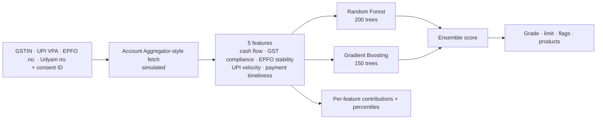

<div align="center">


# 🔮 MSME Financial Health Card

**Credit scoring for small businesses that banks usually turn away, built from GST, UPI, EPFO and payment data and explained factor by factor.**

[](https://fastapi.tiangolo.com/)
[](https://scikit-learn.org/)
[](https://vitejs.dev/)
[](https://leafletjs.com/)
[](https://firebase.google.com/)

[The problem](#the-problem) · [What the card shows](#what-the-card-shows) · [How the score works](#how-the-score-works) · [Run locally](#run-locally) · [API](#api)

</div>

---

## The problem

Banks underwrite MSME loans from audited balance sheets and ITRs.
**New-to-Credit (NTC)** and **New-to-Bank (NTB)** businesses often have neither, yet many of them file GST every month, take UPI payments every day and pay salaries through EPFO. That data shows how healthy a business really is, but a traditional scorecard never looks at it.

## The idea

Fetch the business's **alternate data** with its consent, score it with machine learning, and give the underwriter one card that says how healthy the business is, how much credit it can safely take, and **why**.

## What the card shows

| | |
|---|---|
| 🎯 **Health score and credit grade** | A 0–100 score mapped to a rating band, with the reason for that band |
| 💰 **Estimated credit limit** | A suggested limit based on score, cash flow and GST turnover, rounded to the nearest ₹1 lakh |
| 🧠 **Explainable AI** | Each factor's contribution to the score, and where the business sits against its peers (percentile) |
| 🚩 **Risk flags** | Specific warnings, such as irregular GST filing, unstable EPFO headcount or late payments |
| 🕸️ **Supply-chain map** | Top buyers and suppliers from GST flows, plotted on a Leaflet map to show network resilience |
| 🏦 **Recommended products** | Credit products that fit the profile, for example working capital or an invoice-discounting line |
| 📄 **PDF report** | One-click export of the card to a bank-ready A4 PDF (html2canvas + jsPDF) |
| 🗂️ **History** | Past assessments, saved per signed-in user in Firestore |

## How the score works



- **Five features**, weighted the way credit teams weigh them: cash-flow health (32%), GST compliance (25%), EPFO stability (18%), UPI velocity (15%) and payment timeliness (10%).
- **Two models** (Random Forest and Gradient Boosting) are trained when the API starts and checked with cross-validation. Their predictions are blended 60 / 40.
- **Explanations** turn each feature's contribution and peer percentile into a plain sentence an underwriter can read.

> [!NOTE]
> This is a hackathon prototype. The models train on **2,000 synthetic MSME profiles** with realistic correlations, and the Account Aggregator / OCEN fetch is **simulated** from the identifiers you enter. Swapping in real AA data needs only a change to the fetch layer.

## Tech stack

| Layer | Technology |
|---|---|
| Frontend | React, Vite, React Router, Recharts, React-Leaflet, html2canvas, jsPDF, Lucide icons |
| Auth and history | Firebase Auth, Firestore |
| Backend | Python, FastAPI, Pydantic |
| ML | scikit-learn (RandomForestRegressor, GradientBoostingRegressor), NumPy, pandas |
| Deploy | Vercel (frontend) |

## Run locally

```bash
git clone https://github.com/kartikeyajay2006/Financial-Health-Score.git
cd Financial-Health-Score

# API: http://localhost:8000
cd backend
pip install -r requirements.txt
uvicorn main:app --reload
```

```bash
# Dashboard: http://localhost:5173 (new terminal)
cd frontend
npm install
npm run dev
```

## API

| Method | Endpoint | Purpose |
|---|---|---|
| `POST` | `/api/analyze-health` | Score a business from its GSTIN, UPI VPA, EPFO and Udyam numbers, and consent ID |
| `GET` | `/health` | Health check |
| `GET` | `/` | Service info and model summary |

The response includes `overall_score`, `credit_grade`, `estimated_credit_limit`, `strengths`, `risks`, `risk_flags`, `xai_explanations`, `supply_chain` and `recommended_products`.

## Author

Built by **[Kartikeya Yadav](https://github.com/kartikeyajay2006)**.
[LinkedIn](https://www.linkedin.com/in/kartikeya2006/) · [Portfolio](https://kartikeya-portfolio-rx7w.vercel.app/)
